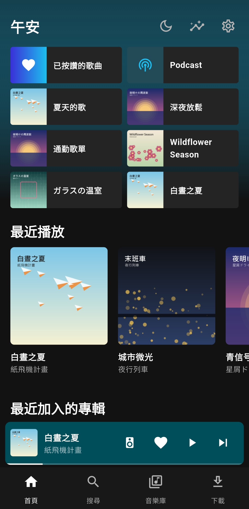
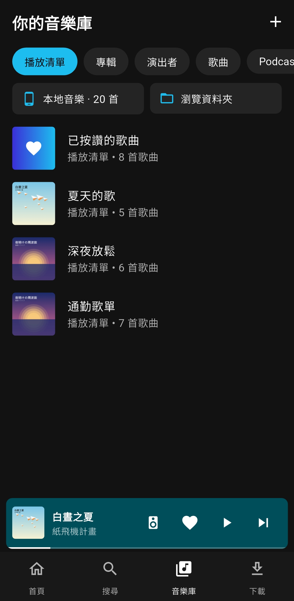
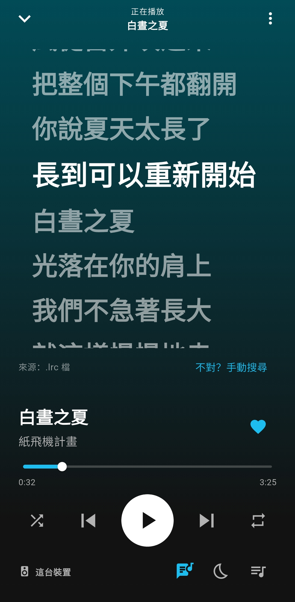
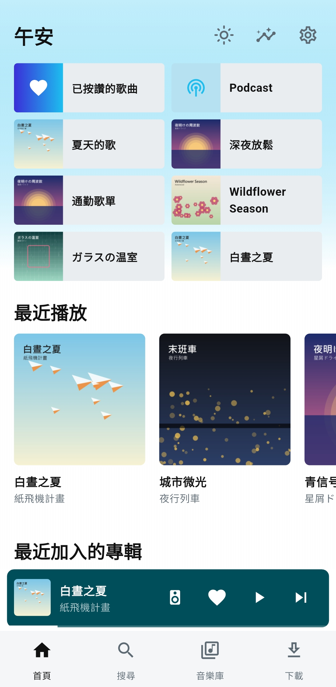
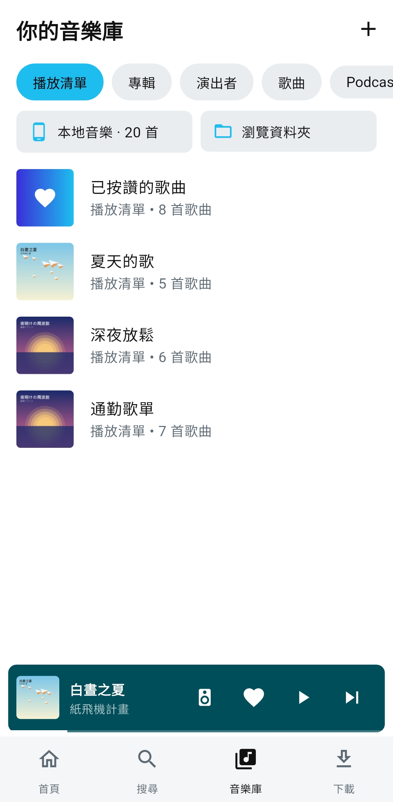
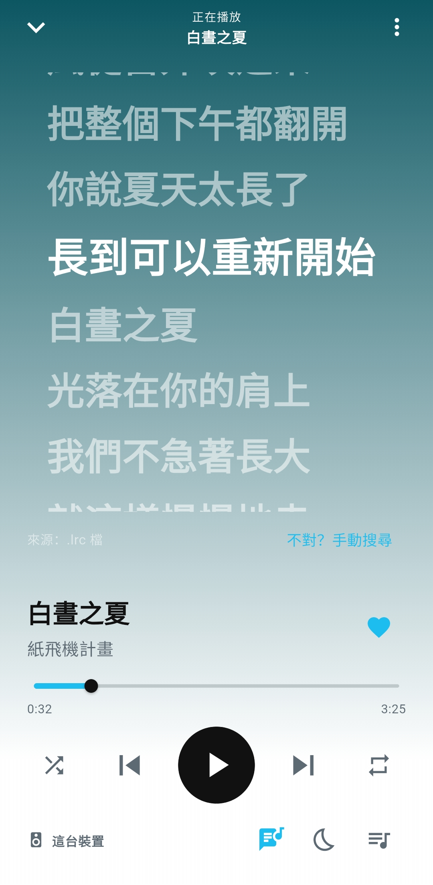

<a href="README.md">繁體中文</a>

  

<h1 align="center">OuOPlayer</h1>

  A local music player as easy to use as a streaming app 
  Android ・ Free ・ Open source (GPL-3.0) ・ No ads, no data collection

  <a href="https://github.com/HowardWang818/OuOPlayer/releases/latest"><b>Download the latest version</b></a>

> The app itself is in Traditional Chinese.

## Screenshots

<table>
  <tr>
    <td align="center"> Home</td>
    <td align="center"> Library</td>
    <td align="center"> Synced lyrics</td>
  </tr>
  <tr>
    <td align="center"> Home (light)</td>
    <td align="center"> Library (light)</td>
    <td align="center"> Synced lyrics (light)</td>
  </tr>
</table>

All artists, songs and covers in the screenshots are made-up demo data.

## Download

Get the APK from [Releases](https://github.com/HowardWang818/OuOPlayer/releases/latest) (Android 7.0+). After that, the app updates itself.

A Windows version is on the way.

## Features

**Playback**
- Background playback, controls in the notification, on the lock screen, and from Bluetooth headphones and car buttons
- Equalizer, volume normalization, fade on play/pause, sleep timer
- Drag to reorder the queue; keep playing at random when it ends

**Library**
- Scans the music on your phone, sorted by album, artist and song
- Browse by folder, and create, rename or delete folders and move songs between them right in the app
- Finds proper cover art for songs without one; artist photos fetched automatically, or pick your own and rename artists
- Select several songs to edit their details, add them to a playlist, hide or delete them at once

**Playlists**
- Your own playlists and playlist folders, with custom covers
- Smart playlists: most played, recently added, not played lately, never played
- Import M3U and Spotify playlists (Spotify data export or Exportify CSV); songs you don't have yet keep their place and are filled in once they show up

**Lyrics**
- Synced lyrics scroll with the song; tap a line to jump there
- Looked up in the song file, a `.lrc` file next to it, then [LRCLIB](https://lrclib.net); fetch lyrics for a whole library or playlist in one go
- Japanese and Chinese songs get lyrics in the original script, not romanized versions
- The line being sung can show in Android Auto and in the notification

**Podcasts**
- Search, subscribe, download episodes
- Remembers where you stopped in every episode; playback speed and silence skipping

**Car and Bluetooth**
- Android Auto: browse playlists, albums and podcasts, or search by voice
- Resumes when Bluetooth headphones connect, pauses when they disconnect

**More**
- Listening stats and a year in review
- Manual backups, or automatic ones on a schedule you choose; restore only the parts you want (e.g. just the settings)
- Home screen widgets (4x1 and 2x2)
- Dark and light themes; the app icon can be light, dark, or follow the theme
- In-app updates

**Downloads**
- Paste a link to download its audio (using [yt-dlp](https://github.com/yt-dlp/yt-dlp)); finished files go straight into your library.
- Only download what you have the right to keep, and follow the source site's terms of service.

## FAQ

OuOPlayer doesn't show up in Android Auto

Android Auto only lists apps from the Play Store until you allow unknown sources:

1. Open Android Auto's settings on your phone (search for "Android Auto" in system settings).
2. Tap "Version" about 10 times and allow developer settings.
3. ⋮ (top right) → Developer settings → tick "Unknown sources".
4. Reconnect to the car.

Why the "Media management" permission?

When deleting or moving songs OuOPlayer didn't download, Android asks for confirmation every time. With media management allowed (設定 → 音樂庫 / Settings → Library), it doesn't. Everything works without it too.

Where do deleted songs go?

To the system trash by default, where the Files app can restore them for about 30 days. With "delete permanently" switched on in 設定 → 音樂庫, they can't be restored.

Lyrics not found, or the wrong song's?

On the lyrics screen tap 「不對？手動搜尋」 (Wrong? Search) to search with an edited title and artist. What you pick is kept.

Moving to a new phone?

On the old phone use 設定 → 備份與還原 → 備份資料 (Settings → Backup → Back up) to save one file, then 從檔案還原 (Restore from file) on the new one. Playlists, likes, play counts, podcasts and settings come along; songs are matched by file location or by title and artist.

## Privacy

OuOPlayer needs no account, shows no ads, and doesn't collect or upload any usage data. Playing your own music needs no internet at all.

It only goes online for the following, and only sends what's listed:

| For | Goes to | Sends | Turn off |
|---|---|---|---|
| Lyrics | LRCLIB | Title, artist, album, length | 設定 → 歌詞 (Settings → Lyrics) |
| Artist photos | Deezer | Artist name | 設定 → 音樂庫 (Settings → Library) |
| Cover art, online search, podcast search | Apple iTunes | Title and artist, or your search text | Only when you use them |
| YouTube Music links | YouTube Data API | Title and artist | Only if you enter your own API key |
| Update checks | OuOPlayer's update server | Nothing | 設定 → 關於與更新 (Settings → About and updates) |
| Downloads, streams, podcasts | The links you paste or subscribe to | — | Only when you use them |

## License

OuOPlayer is released under the [GNU General Public License v3.0](LICENSE).

Thanks to these open-source projects and services:
[Flutter](https://flutter.dev),
[just_audio](https://pub.dev/packages/just_audio),
[audio_service](https://pub.dev/packages/audio_service),
[media_kit](https://github.com/media-kit/media-kit),
[yt-dlp](https://github.com/yt-dlp/yt-dlp),
[youtubedl-android](https://github.com/JunkFood02/youtubedl-android),
[LRCLIB](https://lrclib.net),
[RapidFuzz](https://pub.dev/packages/rapidfuzz),
[Riverpod](https://riverpod.dev),
[sqflite](https://pub.dev/packages/sqflite).

## For developers

Building, versioning and releasing: [docs/DEVELOPMENT.md](docs/DEVELOPMENT.md) (in Chinese).

Most of the code was written together with an AI (Claude); the design, testing and the choices behind every version are HowardWang818's.
